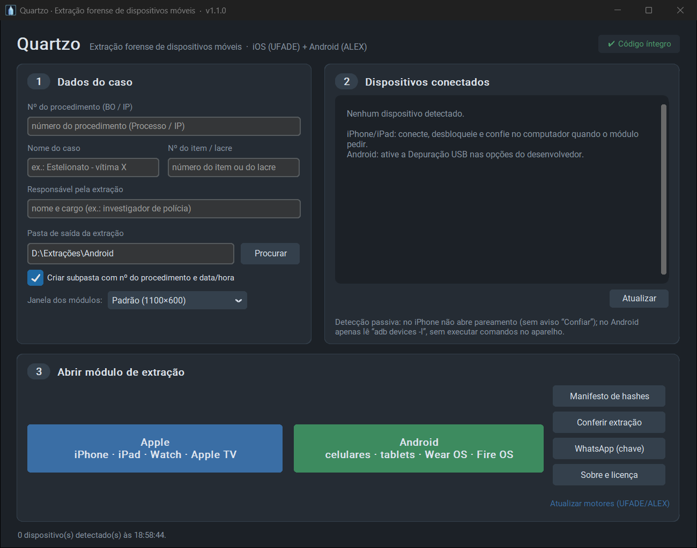
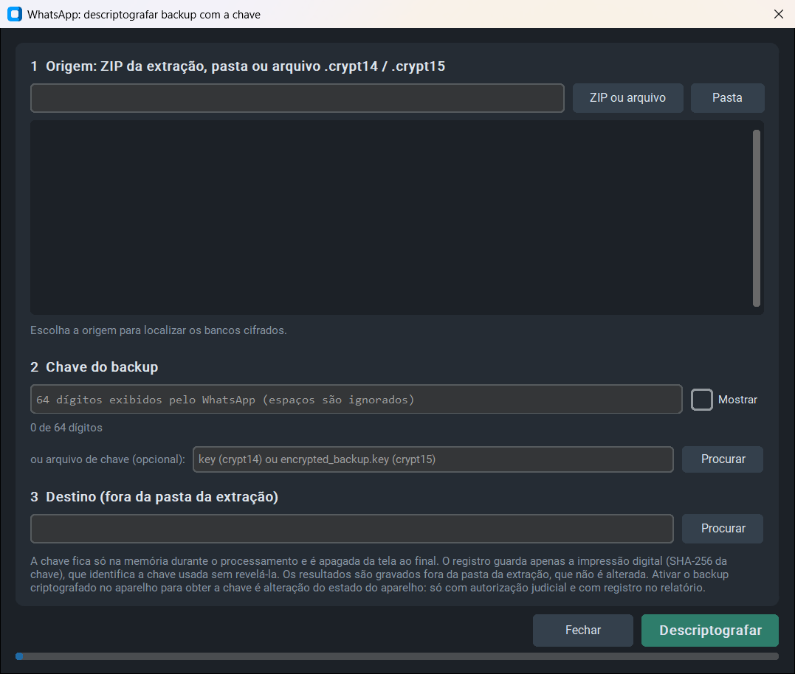

# Quartzo · Extração forense de dispositivos móveis

O Quartzo reúne, numa só instalação e com interface em português, duas ferramentas livres de extração lógica escritas por Christian Peter: o UFADE (Universal Forensic Apple Device Extractor), para iPhone, iPad, Apple Watch e Apple TV, e o ALEX (Android Logical Extractor), para aparelhos Android, Fire OS, Wear OS e Ubuntu Touch. Os dados do caso são digitados uma vez, na tela de entrada, e seguem para o módulo escolhido. Ao lado da extração em si, o Quartzo mantém um log de cada sessão, sela a pasta extraída com um manifesto de hashes e, sempre que é aberto, confere se o próprio código foi alterado.

O nome vem do cristal de quartzo, que marca o tempo nos relógios com precisão. Depois de cada coleta, o Quartzo calcula os hashes de todos os arquivos extraídos e grava o manifesto fora da pasta da evidência, como explicado em [Cadeia de custódia](#cadeia-de-custódia).

O programa depende de 127 pacotes Python, com as versões travadas em `requirements.txt`. Do ALEX ele herda também os métodos de root temporário, tratados em [Cuidados de uso forense](#cuidados-de-uso-forense).

Os projetos originais estão em [prosch88/UFADE](https://github.com/prosch88/UFADE) e [prosch88/ALEX](https://github.com/prosch88/ALEX). O commit de cada um usado nesta versão fica registrado em `upstream/ORIGEM.json`.

## Como a unificação foi feita

O UFADE e o ALEX são programas monolíticos, com cerca de seis mil linhas cada e estado global por módulo, e o autor os atualiza quase todos os dias. Reescrever os dois num único programa obrigaria a reimplementar a lógica de extração, que é justamente a parte mais sensível para a prova, e impediria acompanhar as correções feitas no projeto original. Por isso o Quartzo está organizado em três camadas.

Na primeira fica o código original, sem alterações, em `upstream/`. Na segunda ficam os motores gerados, em `motores/ios` e `motores/android`, que `ferramentas/traduzir.py` e `ferramentas/integrar.py` produzem automaticamente a partir do original. A terceira é o lançador (`quartzo.py`), a porta de entrada: ele recebe os dados do caso, detecta os aparelhos conectados, prepara a pasta de saída e abre o motor certo.

O tradutor trabalha sobre a árvore sintática do Python e só substitui as strings que aparecem na tela (rótulos, botões, títulos, mensagens) ou no texto dos relatórios PDF. Nomes de arquivo e de pasta, chaves de plist, comandos ADB, o XML do UFDR, as linhas do arquivo `.ufd` e as frases comparadas com a saída do aparelho ficam em inglês. Os módulos `ufed_style.py` e `case_uco.py`, que geram os formatos lidos pelo Physical Analyzer, pelo IPED e pelo padrão CASE/UCO, nem passam pelo tradutor. No fim, ele compara a estrutura do código traduzido com a do original e interrompe a geração se encontrar qualquer diferença que não seja o texto de uma string.

Em seguida, `ferramentas/integrar.py` aplica os ajustes de código. Todos levam o comentário `# QUARTZO` e constam do aviso de modificação no cabeçalho, como a GPL exige. Nos dois motores, os dados do caso passam a vir do lançador, o log do motor é copiado para o log de sessão do Quartzo e uma sonda de progresso alimenta a janela de acompanhamento. No motor iOS entram também as correções listadas em [Correções aplicadas ao motor iOS](#correções-aplicadas-ao-motor-ios), cujo código está em `quartzo_app/correcoes_ufade.py` (copiado para `motores/ios/quartzo_correcoes.py`). Cada ajuste é localizado por um trecho exato do código original. Se o autor do UFADE alterar esse trecho, a geração para com erro e o ajuste não é aplicado no lugar errado.

## Instalação no Windows

1. Instale o Python 3.11, versão exigida pelos dois motores. Se ainda não o tiver, execute no Prompt de Comando: `winget install -e --id Python.Python.3.11`.
2. Copie a pasta do Quartzo para o local definitivo (por exemplo, `D:\Quartzo`).
3. Dê dois cliques em `INSTALAR.bat`. Ele cria o ambiente virtual `.venv`, instala as dependências dos dois motores e oferece a instalação do Android Platform Tools (ADB), usado com Android, e do app Dispositivos Apple, usado com iPhone e iPad.
4. Para usar as opções de desenvolvedor do módulo iOS (capturas de tela e listagem do sistema de arquivos), execute também `BAIXAR_IMAGENS_DEV.bat`, que baixa as DeveloperDiskImages. Ele precisa do Git (`winget install -e --id Git.Git`).
5. Habilite os caminhos longos no Windows (chave `LongPathsEnabled`). Os backups do iOS criam caminhos que passam do limite padrão.
6. Execute `QUARTZO_DIAGNOSTICO.bat`. Sem tocar em nenhum aparelho, ele confere o Python, as dependências dos dois motores, o ADB, o serviço da Apple, os caminhos longos, o espaço em disco e a integridade do código, e salva o resultado na pasta `_diag`.

## Uso

1. Abra a ferramenta com `INICIAR_QUARTZO.bat`. Se algo der errado, use `QUARTZO_CONSOLE.bat`, que deixa o console aberto com as mensagens de erro.
2. Preencha os dados do caso: número do procedimento (BO ou IP), nome do caso, número do item ou lacre e responsável pela extração. Esses dados vão para o log da sessão e aparecem já preenchidos nos formulários dos relatórios PDF e UFDR dos motores.
3. Escolha a pasta de saída. Com a opção de subpasta marcada, o Quartzo cria `<pasta>\<nº do procedimento>\<data_hora>_<Apple|Android>_<item/lacre>`. O item ou lacre só entra no nome quando preenchido; se o texto não começar por "item" ou "lacre", recebe o prefixo `item_`.
4. Conecte o aparelho. O painel da direita mostra o que foi detectado. A detecção é passiva: no iPhone, o Quartzo consulta apenas o serviço usbmuxd e não abre pareamento, de modo que o aviso "Confiar neste computador" não aparece; no Android, ele só executa `adb devices -l` no computador e não roda nenhum comando dentro do aparelho.
5. Clique em **Apple** ou em **Android**. O lançador se recolhe e o módulo abre em português, já apontando para a pasta de saída.
6. Quando o módulo começa a transferir dados, abre-se a janela **Acompanhamento da extração**, descrita abaixo.
7. Ao fechar o módulo, o lançador volta à tela e sela a extração. Ele calcula MD5, SHA-1 e SHA-256 de cada arquivo da pasta da extração e grava o manifesto, o registro e o selo SHA-256 numa pasta irmã, ao lado da pasta da extração, com o mesmo nome e o sufixo `__SELO`. A pasta da evidência não recebe nenhum arquivo novo. A selagem acontece na própria estação, logo depois da coleta e antes de a pasta ser manuseada ou movida. Antes do cálculo, o log da sessão recebe uma linha de encerramento e deixa de ser alterado, para que o hash dele, registrado no manifesto, continue válido.

## Acompanhamento da extração

Quando uma operação do módulo começa a avançar, o Quartzo abre no canto direito da tela uma janela própria, pensada para o responsável pela extração. Ela mostra a etapa em curso (com os mesmos textos da tela do módulo), o percentual, o tempo restante estimado e o horário previsto de término. Mostra também quanto tempo a etapa e a sessão já levaram, quantos arquivos foram extraídos, o ritmo em arquivos por segundo com o tamanho médio recente, o volume gravado na pasta da extração, a taxa de gravação e a pasta do aparelho que está sendo copiada naquele momento.

Quando o motor grava os arquivos dentro de um ZIP, como no Logical+ padrão UFED, a contagem é feita pelos cabeçalhos do próprio ZIP, lidos em modo compartilhado e sem abrir o conteúdo, e por isso não interfere na gravação. A opção "Sempre visível" mantém a janela na frente das outras, e o botão "Recolher" a minimiza sem interromper nada.

A estimativa usa o ritmo de avanço dos últimos três minutos da etapa (ou de um período maior, quando o avanço é muito lento) e só aparece depois de alguns segundos de transferência. Em trechos com muitos arquivos pequenos, como caches de miniaturas com dezenas de milhares de itens, o percentual, que é calculado por bytes, anda devagar e a estimativa fica alta demais. Nesses trechos a janela mostra o selo "ARQUIVOS PEQUENOS", marca o tempo restante como "ritmo atual" e explica o motivo; o início e o fim do trecho ficam no log da sessão. Se o percentual parar mas a pasta continuar recebendo arquivos, a janela avisa que não há travamento. Quando o motor não informa o volume total da etapa (barra indeterminada, ou a barra "em ciclos" que o motor Android usa quando não sabe o total), a janela diz que a estimativa não está disponível em vez de inventar um número, e o acompanhamento passa a ser feito pelo volume gravado e pela taxa. Se o percentual ficar parado por mais de um minuto, a janela lembra que o aparelho pode estar esperando desbloqueio, senha ou confirmação.

A janela roda no processo do lançador, separado do módulo. Ela lê o andamento por meio de uma sonda (`quartzo_progresso.py`) que só copia o que a barra de progresso do módulo já mostra. A sonda não altera nenhum valor, não se comunica com o aparelho e não grava nada na pasta da extração; o arquivo de estado fica na pasta temporária do Windows. O início e o fim de cada etapa, com a duração, o último percentual exibido e o volume gravado, ficam no log da sessão.

## Registro de sessão, hashes e integridade

Cada vez que um módulo é aberto, o Quartzo cria na pasta de saída o arquivo `QUARTZO_sessao_<data_hora>.log`. Ele traz a data e a hora local e UTC, os dados do caso, o usuário e o computador, as versões do Python e das bibliotecas forenses, a situação do relógio do Windows (se o serviço de horário está sincronizando), a versão e o commit de cada motor, o resultado da verificação de integridade do código e os aparelhos detectados. Todos os eventos que o motor registra durante a extração são copiados para esse arquivo, com data, hora e a identificação do motor. No motor Android, isso inclui cada comando ADB e fastboot executado, escrito como seria digitado no terminal.

O botão **Manifesto de hashes** percorre uma pasta e grava `manifesto_hashes_<data_hora>.csv`, com o caminho relativo, o tamanho, a data de modificação em UTC e os hashes MD5, SHA-1 e SHA-256 de cada arquivo. Depois, cada arquivo é lido de novo e conferido com o manifesto. O resultado dessa segunda leitura, com a hora de início e de fim e as divergências encontradas, vai para `manifesto_hashes_<data_hora>.registro.txt`. O arquivo `.sha256` guarda o hash do manifesto e o do registro, no formato aceito por `sha256sum -c`. Os hashes gerados pelo Quartzo foram conferidos com `md5sum`, `sha1sum` e `sha256sum`.

Ao final de cada extração, esse mesmo cálculo roda sozinho. O manifesto, o registro e o selo vão para a pasta irmã com sufixo `__SELO`, e a pasta da extração fica como estava. O registro anota o caminho da pasta de evidência a que os hashes se referem, o número do procedimento, o item ou lacre, o responsável e o nome e o SHA-256 do log da sessão. O botão **Manifesto de hashes** continua disponível para conferir qualquer pasta à mão e segue a mesma regra: o manifesto vai para a pasta irmã e a pasta conferida não recebe nenhum arquivo. Se a pasta escolhida for a raiz de uma unidade, onde não existe pasta irmã, o Quartzo pede ao operador outro local, fora dela.

Durante o cálculo, os arquivos de saída ficam numa subpasta `_parcial` e só passam para a pasta do selo, completos, no final; se o processo for interrompido, a subpasta é descartada. O Quartzo não fecha enquanto houver selagem, conferência, atualização dos motores ou descriptografia em andamento. Quando o log da sessão está dentro da pasta selada, ele é encerrado antes do cálculo e não recebe mais nenhuma linha; o que precisa ser anotado depois disso vai para o registro. O Quartzo não assina o manifesto nem obtém carimbo de tempo (veja [Cadeia de custódia](#cadeia-de-custódia)).

O arquivo `integridade.json` guarda o SHA-256 de cada arquivo de código do Quartzo e dos motores, e também dos binários que o motor Android envia ao aparelho ou executa nele (pasta `ressources`). A cada abertura, o lançador recalcula esses hashes e compara. O selo no canto superior direito da tela mostra "Código íntegro" ou lista os arquivos alterados, e o resultado vai para o log da sessão. Sempre que o código for alterado de propósito, regenere a base com `python ferramentas/gerar_integridade.py`.

## Atualização dos motores

Para trazer as correções mais recentes do UFADE e do ALEX, clique em **Atualizar motores (UFADE/ALEX)**, na tela inicial, ou execute `ATUALIZAR_MOTORES.bat`. O link mostra os commits em uso e pede confirmação; ao final, exibe os novos commits e o resultado da tradução. A atualização é recusada enquanto houver um módulo de extração aberto.

Evite atualizar às vésperas de uma coleta real ou logo depois dela. Num caso concreto, mantenha a versão congelada e registre no relatório o commit usado.

O script baixa a versão atual dos dois repositórios, substitui `upstream/`, regenera os motores traduzidos e lista as strings de interface novas que ainda não têm tradução. Elas continuam funcionando em inglês até serem acrescentadas a `i18n/ufade.pt_BR.json` ou `i18n/alex.pt_BR.json`; depois disso, basta rodar `ATUALIZAR_MOTORES.bat --offline`. Se o autor original tiver mudado algum trecho onde o Quartzo faz ajuste de integração, o processo para com uma mensagem de erro e não aplica a modificação no lugar errado.

## Cadeia de custódia

O Quartzo cuida da parte da cadeia de custódia que acontece na estação de extração: o registro de sessão com os dados do caso e os eventos do motor, a selagem automática da pasta da extração e a verificação do próprio código. Os hashes são calculados na estação assim que o motor termina de gravar, antes de a pasta ser manuseada ou movida, e o selo fica na pasta irmã (sufixo `__SELO`), sem alterar a evidência. Depois de cada extração:

1. confira, na mensagem "Selagem da extração", que todos os arquivos bateram na segunda leitura;
2. transcreva no documento oficial (auto, termo ou relatório) o SHA-256 do manifesto, que está no arquivo `.registro.txt` e na primeira linha do arquivo `.sha256`, na pasta irmã. É essa transcrição que liga a extração ao procedimento, já que o Quartzo não assina o manifesto nem obtém carimbo de tempo;
3. guarde a pasta irmã junto com a pasta da extração, sem alterar nenhuma das duas;
4. para conferir a extração mais tarde (ao remetê-la ou anexá-la, por exemplo), verifique primeiro se o SHA-256 do manifesto é o mesmo transcrito no documento oficial e depois use o botão **Conferir extração**. Escolha o manifesto e a pasta da extração; o Quartzo relê cada arquivo, confere tamanho, MD5, SHA-1 e SHA-256 e grava o relatório `conferencia_<data_hora>.txt` ao lado do manifesto (ou na pasta irmã, se o manifesto estiver dentro da evidência), com a lista das divergências, se houver.

O relatório deve informar que os hashes foram calculados ao término da coleta, logo após a gravação pelos motores, e não byte a byte durante a aquisição. Deve informar também o motor e o commit usados, a situação do relógio da estação (os dois constam do log da sessão; mantenha o serviço de horário do Windows ativo e sincronizado) e as alterações feitas no aparelho, descritas em [Cuidados de uso forense](#cuidados-de-uso-forense).

O IPED não descriptografa backups do iTunes. O ZIP do Logical+ padrão UFED guarda o backup criptografado, com a senha no `.ufd` para uso no Physical Analyzer. Para o IPED, use o resultado de "Descriptografar e reconstruir backup" ou o Logical+ padrão UFADE.

## Descriptografia de backups do WhatsApp

O botão **WhatsApp (chave)** abre uma janela que descriptografa os bancos que o WhatsApp para Android grava cifrados em `/sdcard/Android/media/com.whatsapp/WhatsApp/Databases` e `Backups` (e nas pastas equivalentes do WhatsApp Business). O IPED reconhece o `msgstore.db.crypt14` ou `.crypt15` pelo nome, mas não tem como receber a chave e por isso não abre esses arquivos. O Quartzo grava os bancos em claro numa pasta à parte, que depois entra no caso do IPED como nova fonte de dados.

Cada um dos dois formatos abre com uma chave diferente:

1. O `crypt15` aparece quando o backup com criptografia de ponta a ponta está ativado no WhatsApp. Abre com a chave de 64 dígitos hexadecimais (256 bits) que o próprio WhatsApp exibe quando o recurso é ativado com a opção de chave, e não de senha, ou com o arquivo `files/encrypted_backup.key` da pasta interna do app.
2. O `crypt14` é a criptografia local que o WhatsApp usa sempre que aquele recurso está desligado. Abre apenas com o arquivo `files/key` da pasta interna do app (`/data/data/com.whatsapp/`), que exige root ou extração completa do sistema de arquivos. A chave de 64 dígitos não serve para ele.

Na janela, escolha como origem o ZIP da extração PRFS, a pasta da extração ou um arquivo avulso. A lista mostra cada banco encontrado, com o formato já identificado. Digite ou cole a chave (espaços e letras maiúsculas são aceitos, e um contador mostra quantos dos 64 dígitos já foram informados) ou indique o arquivo de chave. O destino sugerido é a pasta irmã `<pasta da extração>__WHATSAPP`, no mesmo padrão do selo de hashes, e a janela recusa qualquer destino dentro da pasta da extração. Cada execução cria `WhatsApp_<data_hora>` com os bancos, `registro_whatsapp_<data_hora>.txt`, `hashes_whatsapp_<data_hora>.csv` e o `.sha256` dos dois.

Cada arquivo é lido duas vezes. Na primeira leitura, o Quartzo calcula MD5, SHA-1 e SHA-256 da origem e confere o MD5 que o WhatsApp grava no fim do arquivo. Na segunda, decifra (AES-256-GCM), descompacta (zlib) e grava o resultado como `<nome>.parcial`, que só recebe o nome definitivo depois de conferida a tag de autenticação GCM. Se a tag não bater, o arquivo parcial é apagado e o original é dado como corrompido ou adulterado. O resultado é relido para conferir o SHA-256, e os bancos SQLite são abertos somente para leitura, em modo imutável, para o `quick_check` e a contagem de mensagens, conversas e contatos.

A chave fica só na memória e é apagada da tela ao final. O registro guarda apenas a impressão digital (SHA-256 da chave raiz), que identifica a chave usada sem revelá-la. O formato foi conferido byte a byte com a ferramenta de referência wa-crypt-tools, de ElDavoo (GPL-3.0), em arquivos crypt14 e crypt15 reais, inclusive backups divididos em vários arquivos.

Nos backups protegidos por senha ou por passkey, o WhatsApp não exibe a chave de 64 dígitos. A senha e a passkey não decifram o backup; elas protegem a chave guardada nos servidores do WhatsApp. Esses backups abrem com o arquivo `files/encrypted_backup.key` da pasta interna do app. O cabeçalho do arquivo indica esses casos, e o Quartzo explica isso quando a chave informada não abre o arquivo.

Pela linha de comando, a chave é pedida sem eco, para não ficar no histórico: `.venv\Scripts\python.exe -m quartzo_app.whatsapp_cripto "<ZIP, pasta ou arquivo>" "<destino>"`. Use `--listar` para apenas ver os bancos encontrados e `--arquivo-chave <arquivo>` para usar `key` ou `encrypted_backup.key`.

Ativar o backup criptografado no aparelho e disparar um backup para obter o crypt15 altera o estado do aparelho. Isso só deve ser feito com autorização judicial que contemple o acesso ao conteúdo, com registro no relatório (hora, operador e impressão digital da chave) e, de preferência, com a sessão gravada em vídeo. O recurso vale da ativação em diante: os crypt14 que já existiam continuam exigindo o arquivo `key`.

## Cuidados de uso forense

Os motores mantêm comportamentos do original que alteram o estado do aparelho e que precisam constar do relatório.

Ao fazer backup de um aparelho sem senha de backup, o módulo iOS ativa a criptografia do backup com a senha técnica `12345`, necessária para obter os dados protegidos, e tenta removê-la ao final. Se o aparelho já tinha senha de backup, ela é trocada temporariamente pela senha técnica e restaurada no fim. Cada uma dessas alterações, o resultado da restauração, o pareamento com o computador e a montagem da imagem de desenvolvedor ficam no log da sessão com a marca "ALTERAÇÃO NO APARELHO". A senha nunca é gravada no log. Se a restauração falhar, o log registra que o aparelho ficou com a senha técnica, e a opção "Remover senha de backup do UFADE" permite retirá-la.

O módulo Android oferece, na área de exploits, métodos de root temporário (CVE-2016-5195, CVE-2016-10277, CVE-2020-0069, CVE-2024-0044 e CVE-2024-31317). Eles gravam arquivos temporários no aparelho e, no caso do initroot, podem provocar bootloop. Só devem ser usados com autorização judicial que os contemple e com registro no relatório. O backup ADB e o Logical+ do Android podem pedir interação na tela do aparelho, e por isso convém gravar em vídeo toda a sessão de extração.

## Correções aplicadas ao motor iOS

As falhas abaixo apareceram no teste de coleta de 16/10/2026 (iPhone 16e, iOS 26.6.2). A cada geração do motor, `ferramentas/integrar.py` aplica a correção correspondente.

1. **Arquivos perdidos na descriptografia.** O original percorria só os caminhos relativos distintos do `Manifest.db` e ficava com o primeiro domínio de cada um. Quando o mesmo caminho existia em mais de um app (por exemplo `Library/Cookies/Cookies.binarycookies`), só a cópia do primeiro app era gravada; no teste, 967 arquivos ficaram de fora. O Quartzo passou a descriptografar cada registro pelo seu `fileID`, que é único, e desde o commit `771aead` (22/10/2026) o próprio UFADE faz o mesmo. O Quartzo mantém o que o original ainda não cobre: os arquivos de tamanho zero são gravados (o UFADE só registra que os pulou), e o log informa o total de registros, os gravados e as falhas. No PRFS, quando dois registros apontam para o mesmo caminho no aparelho, o UFADE grava no ZIP só o primeiro e anota o outro no log; o resumo do Quartzo informa quantos ficaram de fora por isso. Tudo isso vale para o Logical+ padrão UFADE (TAR), o PRFS (ZIP) e as opções "Descriptografar" e "Descriptografar e reconstruir backup".
2. **ZIP vazio após cancelamento.** Se a senha do backup não fosse informada, se o operador voltasse ao menu ou se o backup falhasse, o Logical+ seguia em frente e gravava um ZIP vazio. Agora ele para e registra o motivo no log.
3. **Senha no log.** A senha de backup informada ou descoberta deixou de ser gravada no log. O `.ufd` continua trazendo a senha técnica, que o Physical Analyzer exige.
4. **Alterações no aparelho.** Passaram a ser registradas no log (veja [Cuidados de uso forense](#cuidados-de-uso-forense)). Quando a senha original do aparelho já era `12345`, ela é mantida no final, em vez de a criptografia ser removida.
5. **Nomes inválidos no Windows.** Pastas da área de mídia (AFC) com `|` no nome, como `FeaturedPhoto|<UUID>`, não eram gravadas. O caractere agora é trocado por `-`, como o motor já fazia com `:`, e a troca é anotada no log.
6. **Fuso horário do `.ufd`.** O arquivo trazia `(--3)` e passou a trazer `(-3)`. O mesmo vale para o UFDR do Apple Watch.
7. **ZIP padrão UFED sem compressão.** O conteúdo já vem criptografado, e a compressão não reduzia o tamanho; só deixava a gravação e a leitura mais lentas.
8. **Arquivos compartilhados de apps.** O log informa quantos arquivos cada app entregou. No modo PRFS, esses arquivos não chegavam a ser gravados no ZIP.
9. **CASE/UCO.** O `@context` do `.case.json` declara os prefixos `uco-action`, `uco-tool`, `uco-configuration` e `drafting`, usados no grafo, e o arquivo passou a trazer o IMEI 2 e os cartões SIM (ICCID e IMSI).
10. **Reconstrução sem tocar na evidência.** Em "Descriptografar e reconstruir backup" ou "Descriptografar", basta escolher a pasta onde estão o `.ufd` e o ZIP padrão UFED (por exemplo `01_EVIDENCIA_ORIGINAL`), sem descompactar o ZIP. O motor confere o SHA-256 do ZIP com o que está registrado no `.ufd`, copia o backup para uma pasta temporária `Quartzo_backup_temporario\<UDID>_<data_hora>` e apaga essa cópia no final; os hashes MD5, SHA-1 e SHA-256 do arquivo gerado vão para o log. A cópia nunca é feita dentro da pasta do ZIP nem da pasta da sessão, que, quando a reconstrução vem logo depois da extração, é a própria pasta da evidência. O motor tenta, nesta ordem, a pasta indicada na variável de ambiente `QUARTZO_TEMP`, a pasta temporária do Windows e a raiz da unidade do ZIP (`D:\_Quartzo_backup_temporario`), fica com a primeira que tenha espaço para o backup mais 1 GB e anota no log a pasta usada. A pasta da sessão também precisa de espaço para o arquivo reconstruído. O resultado reúne o conteúdo do backup; as mídias AFC e os arquivos compartilhados de apps continuam só no ZIP UFED.

## Estrutura de pastas

`quartzo_app` tem o código do lançador (detecção, hashes, integridade) e as correções do motor iOS (`correcoes_ufade.py`). `motores` tem os motores gerados, prontos para uso. `upstream` guarda o código original e o `ORIGEM.json`. `i18n` guarda os dicionários de tradução (`comum`, `ufade` e `alex`). `ferramentas` reúne o tradutor, os ajustes de integração, a sincronização, o autodiagnóstico e o gerador da base de integridade. As imagens deste README ficam em `docs/imagens`.

## Créditos e licença

UFADE e ALEX são de Christian Peter ([github.com/prosch88](https://github.com/prosch88)), licenciados sob a GNU GPL v3. Eles dependem de projetos como pymobiledevice3, iOSbackup, pyiosbackup, adbutils, CustomTkinter, paramiko e pdfme, e usam técnicas do android_triage (RealityNet), do mtk-su (diplomatic) e do lyto (eeriemyxi), como informam os READMEs originais em `upstream/`.

O Quartzo (lançador, tradução e ferramentas de geração) é Copyright (C) 2026 Jean Carlos Fonseca e também é distribuído sob a GNU General Public License, versão 3 ou posterior (arquivo `LICENSE`). Este programa é distribuído na esperança de ser útil, mas SEM QUALQUER GARANTIA, nem mesmo a garantia implícita de COMERCIABILIDADE ou ADEQUAÇÃO A UM FIM ESPECÍFICO.
